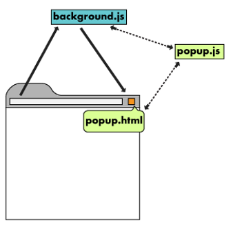
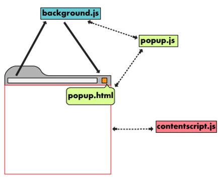
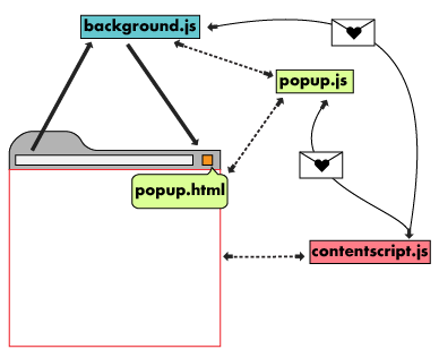

<p align=center><a href="https://chrome.google.com/webstore/detail/video-speed-regulator/admmbgfajonomekanjdmicnnhiojcfop" target="_blank" rel="noopener noreferrer"></a></p>

# Chrome Browser Extension - Video Playback Rate

This extension is primarily for _chrome_ and (so far) mostly based on the getting started tutorial from [Chrome Developers](https://developer.chrome.com/docs/extensions/mv3/getstarted/).

## Why does this repository exist?

Well ... quite simple:

- I wanted to check out how a browser extension is made (a bit more hands-on)
- Wanted to explore some new things (e.g. Typescript, Vite, Formatting, Linting, Workflows, GH-Hooks and so on...)
- Even though there are already extensions out there to increase the speed of a video, I wanted my own 🤪

I'm just getting started with this and build it in public in order to hold myself accountable and actually pull through. 🪅 Progress will be slow due to lots of other thing going on in my life.

## ToDo

- [x] Actually implement the core/base functionality (KISS)
- [x] How is an extension being deployed?
- [x] How is a third party library being added (npm)?
  - Kind of answered this myself, although not really using a third party library but WebComponents instead

What else could I do with it?

- [x] Rework UI & use ShadowParts (Shadow DOM CSS)
- [x] Add proper error-handling
- [x] Make extension [themable](https://sap.github.io/ui5-webcomponents/playground/advanced/configuration/#theme) (include in options)
- [x] Learn more about .d.ts files and how to declare & add them into the project
- [x] Make UI respect your latest change within the tab (if you selected 2 and reopen the extension it should also reflect speedValue 2)
- [x] Configure formatting & linting with [oxfmt and oxlint](https://oxc.rs) (incl. complexity limits)
- [x] Rethink the folder structure
- [x] Configure [Vite](https://vitejs.dev/) for building the project
  - TS => JS => bundle/build/merge JS + Public folder => Dist
- [?] Make extension cross-browser compatible
- [?] Refactoring & Creation of Types

## Development

Requires Node.js 24+.

```sh
npm ci                                # also installs the git hooks (lint + typecheck before each commit)
npx puppeteer browsers install chrome # browser for the e2e tests, if npm skipped puppeteer's install script
npm run build                         # builds the extension into dist/
```

Load `dist/` as an unpacked extension via `chrome://extensions` (developer mode). `npm run build:watch` rebuilds on changes.

The build runs in two steps: `vite.config.ts` bundles the ES module entries (`sw`, `popup`, `options`) and copies `public/` (injecting `version` from `package.json` into `dist/manifest.json`), while `vite.contentscript.config.ts` bundles `src/contentscript.ts` as a self-contained classic IIFE so Chrome can inject it declaratively via `content_scripts` without `web_accessible_resources`.

| Script                      | What it does                                                          |
| --------------------------- | --------------------------------------------------------------------- |
| `npm run lint` / `lint:fix` | oxlint (incl. complexity limits) and the oxfmt format check / autofix |
| `npm run typecheck`         | TypeScript without emitting                                           |
| `npm run build`             | Cleans `dist/` and builds both ESM entries and the content script     |
| `npm run test:unit`         | Unit tests (Vitest + jsdom); `test:watch` and `test:coverage` too     |
| `npm run test:e2e`          | Builds, then runs the real extension in Chrome via Puppeteer          |
| `npm test`                  | Builds, then runs both suites                                         |
| `npm run zip`               | Packs `dist/` into `cbe-vpr_<version>.dist.zip`                       |

**Releasing:** bump `version` in `package.json` (the manifest takes it from there), merge to `master` and push a matching tag (`1.2.3` or `v1.2.3`). The `create release` workflow checks that the tag is on `master` and matches the version, runs all checks, and attaches the zip to a GitHub release.

`allowScripts` in `package.json` pins the puppeteer version whose install script was reviewed. After a puppeteer update, review it and run `npm approve-scripts puppeteer`.

## Architectural _Overview_ of an Extension

The full and official introduction (from Chrome) can be found [here](https://developer.chrome.com/docs/extensions/mv3/architecture-overview/).

_Note:_ With Manifest V3 the "background page" is now using a [Service Worker](https://developer.chrome.com/docs/extensions/mv3/service_workers/).

### High-Level Overview



### Content scripts

More details on content scripts can be found [here](https://developer.chrome.com/docs/extensions/mv3/content_scripts/).



Communication between the content script and the parent extension is done either by using the [storage API](https://developer.chrome.com/docs/extensions/reference/storage/) or using [messages](https://developer.chrome.com/docs/extensions/mv3/messaging/).

- **Injection:** `dist/js/contentscript.js` is declared in `manifest.json` (`all_frames: true`, `run_at: "document_idle"`) so Chrome injects it into main frames and dynamically added iframes automatically; `sw.ts` also injects it into already-open tabs on `onInstalled`.
- **Storage:** User preferences (`defaults`, `badgeEnabled`, `theme`) live in `chrome.storage.sync`; ephemeral per-tab playback rates (`playbackRate_<tabId>`) live in `chrome.storage.session` so they clear automatically when the browser closes.
- **UI & theming:** `popup.html` and `options.html` use UI5 Web Components with targeted loaders for `sap_horizon`, `sap_horizon_dark`, and English i18n only (`src/util/ThemeSwitcher.ts`).



## Sources

- [MDN Web Docs](https://developer.mozilla.org/en-US/docs/Mozilla/Add-ons/WebExtensions/Build_a_cross_browser_extension)
- [Chrome Developers](https://developer.chrome.com/docs/extensions/mv3/getstarted/)
  - [What are Extensions?](https://developer.chrome.com/docs/extensions/mv3/overview/)
  - [Debugging Extensions](https://developer.chrome.com/docs/extensions/mv3/tut_debugging/)
  - [Extensions API Reference](https://developer.chrome.com/docs/extensions/reference/)
  - [Examples](https://github.com/GoogleChrome/chrome-extensions-samples)
- [FreeCodeCamp - Browser Extension](https://www.freecodecamp.org/news/write-your-own-browser-extensions/)
- [Chrome Extensions React+TS Starter](https://github.com/chibat/chrome-extension-typescript-starter)
- [UI5 Web Components - Slider Component](https://sap.github.io/ui5-webcomponents/playground/components/Slider/)
- [TS: Typescript Type Declaration Files](https://medium.com/jspoint/typescript-type-declaration-files-4b29077c43)
- [TS: Namespaces](https://medium.com/jspoint/typescript-namespaces-f43cd002c08c)
- [TS: Udemy Course](https://www.udemy.com/course/understanding-typescript)
- [Background Script M3](https://youtu.be/29dmxQ9QQ4o?t=416)
- [GitHub CLI: gh release create](https://cli.github.com/manual/gh_release_create)

<p align=center><a href="https://www.flaticon.com/premium-icon/fast-forward_5148595?term=fast%20forward&related_id=5148595">Icons by Flaticon</a></p>
